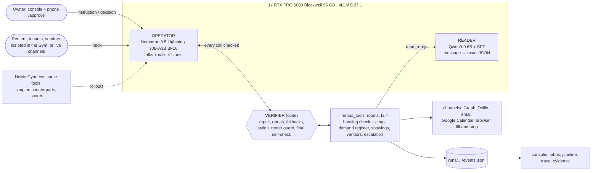

# Rentus Operator

**A room-rental owner's leasing and operations desk, run by small open models on one GPU.**

- **It talks to renters, tenants and vendors** in English and Spanish: answers questions from the room record, qualifies each renter, books showings, follows up, and triages repairs.
- **It does the busywork with 41 tools**: room records, a fair-housing check, listings on several sites, a demand register, showings, vendor quotes, owner escalations.
- **The owner decides only what is his to decide** (price, payment terms, anything that spends money), with one tap on his phone.

One model does all the talking and tool calling: **NVIDIA Nemotron 3.5 Lightning** (30B MoE, 3B active) on **Red Hat vLLM**. A fine-tuned **Qwen3-0.6B reader** turns each renter message into exact JSON. Plain code (the verifier) checks every tool call. A **NeMo Gym** environment measures all of it.

Track: **Tool-Calling**. Bounties: Best Use of NVIDIA Nemotron Lightning · Best Model Improvement with NVIDIA NeMo Gym · Best Use of Red Hat vLLM · NVIDIA Developer Champions Choice ([write-ups](docs/submission.md)).

---

## Headline results

Pre-registered test on **46 realistic held-out leasing tasks** (twins of the owner's real threads, 4 runs per config). Full tables: [docs/results.md](docs/results.md).

| System | Tasks fully passed | Mean reward | Lightning calls / task |
|---|---|---|---|
| Baseline (prompt v1, verbose tools, rule-based reader) | **9.2%** (4 to 21%) | 0.726 | 9.5 |
| **Final** (prompt v4, concierge tools, renter guard, style pre-check, verifier, fine-tuned reader) | **58.2%** (44 to 71%) | 0.930 | 16.0 |
| Final + router (code decides when to call Lightning) | 13.0% (6 to 26%) | 0.702 | 2.8 |
| Reference: Claude Opus 5.5, same harness (1 run, 36-task subset) | 61.1% (45 to 75%) | 0.906 | 14.0 |

The router saves about 80% of Lightning calls (16.0 → 2.8 per task) but fails on quality, so it is **off** in the final system.

**Reader** (90 renter messages the owner labeled blind; exact match of the whole JSON):

| Reader | Exact match |
|---|---|
| **rentus-reader** (Qwen3-0.6B + our fine-tune) | **0.522** |
| Nemotron Lightning 30B, prompted | 0.267 |
| Claude Opus 5.5, prompted (reference) | 0.667 |

### What we can and can't claim

Five hypotheses, one-sided, Holm-corrected at familywise α = 0.025:

- **H1, final beats baseline: supported.** +0.204 mean reward (lower bound +0.170), +48.9 pass-rate points, 35 tasks better and 1 worse.
- **H2a, the 0.6B reader beats Lightning at reading renters: supported.** +0.256 (Holm p = 0.009).
- **H2b, the 0.6B reader beats Opus: not supported.** Opus reads better (−0.144).
- **H3, the router is cheaper without losing quality: not supported.** It loses 0.227 reward.
- **H4, the local system is within 0.05 reward of Opus: not supported after Holm.** The point estimate is +0.014 (local slightly ahead) and it passes uncorrected (p = 0.011), but not at the Holm threshold. So: *close to frontier parity on this harness, not proven*.

**Pass rate is the number that matters.** A trivial agent that only says hello scores **0.841 mean reward** and passes 0 tasks (`gym/results/v3-floors.json`). Pass rates are scorer-defined: the owner's blind grading of the scorer was skipped for time.

---

## What it does

**Leasing concierge** (rules in [docs/spec/concierge.md](docs/spec/concierge.md))
- Demand first: every inquiry goes into a demand register, whether or not a room fits today.
- Full disclosure from the room record only: price, deposit, utilities, bath, availability.
- Exact-answer qualifying gate, in English or Spanish: one-year lease, exact move-in date, phone, reason, headcount. "Early November" is not a date; the reader catches it.
- Showings on **Google Calendar**, only inside the owner's "Available for showings" blocks, never double-booked, and confirmed by the owner.
- Park and reconnect: a renter whose timing is later gets a reconnect date. Follow-ups, matching to other open rooms, and **supply signals** when 5+ qualified people want the same area, type and budget.

**Tenant operations** (owner rules in [docs/playbooks/owner-decisions.md](docs/playbooks/owner-decisions.md))
- Ledger facts looked up exactly; partial payments acknowledged with the exact remainder.
- Payment plans worked out with the tenant, inside bounds the owner set; anything outside goes to him.
- Late-rent ladder: reminder, assess, check in, escalate, with notices sent as the lease requires.
- Maintenance triage; safety emergencies (gas, fire, flooding, CO alarm...) alert the owner immediately and give the tenant safety steps first.
- Vendor quotes side by side; every expense needs the owner's approval.

**Channels** (exact status; [channels/README.md](channels/README.md), [channels/live/README.md](channels/live/README.md))

| Channel | Status |
|---|---|
| Facebook Page | One real post written by the operator, published unedited by the owner (decision D20). Other posts are created unpublished; the console publishes only on the owner's click. |
| Messenger (Page inbox via Graph, personal inbox via browser) | Two-way for allowlisted contacts. On the personal inbox, chats from anyone else become drafts that only the owner's Approve sends. |
| SMS (Twilio) and email (Resend out, Gmail IMAP read-only in) | Two-way for allowlisted contacts in `channels/live`, with kill switch, rate cap and STOP opt-out. The older inbound path saves drafts only. An open public mode exists, off by default, with disclosure and caps. |
| Google Calendar | Real showing events inside availability blocks (service account, no attendees). |
| Craigslist, Roomies, PadSplit, Marketplace | Browser automations fill the whole form, upload photos and **stop before the final submit button**. |

**Safety rules enforced in code, not just in the prompt**
- Never states a room fact the owner has not confirmed (post-freeze fix `76341e3`).
- Never claims "booked" or "published" unless the world state shows it (verifier final self-check).
- First person as the owner, never "the owner"; at most 2 sentences and one question per message; no house numbers in public text; replies in the renter's language.
- Fair-housing check before anything is published (24 CFR 100.75 + HUD guidance).
- Every expense needs owner approval; no discounts promised.

**Recovery**
- The verifier repairs broken JSON, retries rate limits and timeouts, falls back to the next vendor or channel, blocks repeated calls, and escalates after 3 repeats.
- Browser automations repair their own selectors when a site's page changes (`channels/repair/`).

**Owner console** ([console/README.md](console/README.md)): one inbox for every live channel, an assistant, the leasing pipeline, a live trace of every tool call and recovery, approvals on the phone at `/approve`, and evidence tabs with the measured results.

---

## How it works



**Parameter budget** (every generative model the running system loads must sum to ≤ 33B):

| Model | Role | Params |
|---|---|---|
| [NVIDIA-Nemotron-3.5-Lightning-30B-A3B-BF16](https://huggingface.co/nvidia/NVIDIA-Nemotron-3.5-Lightning-30B-A3B-BF16) | operator: all talking and tool calls | 30B (3B active) |
| [xvanov/rentus-reader-qwen3-0.6b](https://huggingface.co/xvanov/rentus-reader-qwen3-0.6b) (Qwen3-0.6B + our SFT) | reader tool | 0.6B |
| **Total** | | **30.6B ≤ 33B** |

The verifier, router logic, scripted counterparts and compliance checks are code. No draft model is loaded. (Raw Hugging Face counts: 31.58B + 0.75B = 32.3B, still under.) Opus 5.5 was used only as an evaluation reference, which the organizers confirmed does not count.

**Why each NVIDIA / Red Hat piece**
- **Nemotron 3.5 Lightning:** a 30B MoE with only 3B active per token, strong at tool calls, fast enough to run a whole desk on one card.
- **NeMo Gym 0.6.0:** a resources server around the same tools, scripted renters and vendors, a scorer with 7 check types, and task sets v1, v2 (synthetic) and v3 (twins of real threads). Every improvement from 9% to 58% was chosen on Gym data.
- **vLLM 0.27.1:** two models on one GPU (reader on 12% of memory, p95 under 0.47 s at every operator load, 0 errors in 507 probes). Prefix caching on the real 6k-token prompt: **+76% throughput at 32 concurrent, +97% at 64**, time to first token −50 to −64%. Reasoning off for routine tool turns: 6.9 → 13.2 turns/s.
- **NVFP4 → BF16:** the 4-bit build crashed under 16 to 48 concurrent agent requests; BF16 ran 2,567 requests in 15.5 minutes with 0 errors, at about 38% lower decode throughput. We chose stability. Details: [docs/vllm.md](docs/vllm.md).

---

## How we evaluated

- **Pre-registered** in [docs/eval-protocol.md](docs/eval-protocol.md) before any confirmatory run: hypotheses, one-sided tests, Holm family, the 0.05 margin, seeds, rerun and void rules.
- **Two rounds of independent review** (`docs/reviews/`) attacked statistics, leakage, scorer and privacy before the freeze.
- **Frozen by hash**: `scripts/freeze.py` hashes every frozen file; the stats code refuses runs off the freeze commit or on dirty files. Runs used a clean worktree of `c81cb21`.
- **Owner blind labels** for the reader test: the labeler ([labeler/README.md](labeler/README.md)) never shows any model's answer.
- **Nine amendments, logged with time and reason**, including the incidents:
  - the first freeze used a partial 22-task set; we re-froze on all 46 before looking at any result and kept the stopped runs labeled as superseded;
  - Claude Code frontier runs hit a subscription rate limit and were voided; Opus was rerun through the OpenCode Zen API on a pre-declared 36-task subset under a $10.50 cap;
  - the H2 analysis moved to all 90 owner-labeled messages (the original 61-message analysis, which is not significant after Holm, is always shown next to it);
  - a safety fix (never state unconfirmed facts) landed after the freeze and is not in the scored runs;
  - the owner skipped the scorer-agreement grading (κ) and the realism review for time, so pass rates are scorer-defined and v3 is "synthetic, realism not confirmed".

---

## Quick start

```bash
git clone https://github.com/xvanov/red-hat-small-models-hack && cd red-hat-small-models-hack
cp .env.example .env          # endpoints and keys, see below
scripts/setup.sh              # root .venv (uv, Python 3.12): tools, operator, console, channels + Chromium
scripts/setup.sh --gym        # optional: Gym venvs (Python 3.13 + nemo-gym 0.6.0)
scripts/doctor.sh --quick     # tunnels, both model endpoints, every package's tests
scripts/demo.sh               # console at http://localhost:8080
```

In the console click **▶ Demo run**, or type `Appling Way room free Nov 1, $750, private bath`. With no GPU, `CONSOLE_FORCE_STUB=1 scripts/demo.sh` runs a rule-based rehearsal and the badge says **stub**.

| Variable | Value |
|---|---|
| `OPERATOR_BASE_URL` / `OPERATOR_MODEL` / `OPERATOR_API_KEY` | `http://localhost:8000/v1` / `nemotron-3.5-lightning` / the vLLM `--api-key` |
| `READER_BASE_URL` / `READER_MODEL` / `READER_API_KEY` | `http://localhost:8011/v1` / `rentus-reader` / same key |
| `BREV_API_KEY` | Brev CLI key for the GPU instance and SSH tunnels |

**GPU, one command:** `serving/rebuild.sh` creates the Brev instance (1x RTX PRO 6000 Blackwell 96 GB), starts vLLM with Lightning BF16 (flags frozen in `serving/FROZEN.json`), serves the reader on the same card, opens both tunnels and runs a smoke test. `--dry-run` prints every step; rerun is safe.

**Reproduce the confirmatory results:**

```bash
git checkout c81cb21
V3=gym/tasks/v3/heldout.jsonl; OC='{"prompt_version":"v4","tool_descriptions":"concierge","guard_stand_down":true}'
gym/.venv/bin/python gym/run_seeds.py --variant base --tasks-file $V3 --seeds 1,2,3,4,5 --prefix v3-heldout-baseline --workers 5
gym/.venv/bin/python gym/run_seeds.py --variant guard+prompt3+style+rhist+readermodel --operator-config "$OC" \
    --tasks-file $V3 --seeds 1,2,3,4,5 --prefix v3-heldout-final --workers 5
gym/.venv/bin/python gym/run_seeds.py --variant guard+prompt3+style+rhist+readermodel+router --operator-config "$OC" \
    --tasks-file $V3 --seeds 1,2,3,4,5 --prefix v3-heldout-final-router --workers 5
gym/.venv/bin/python gym/h2_combined.py --plan gym/confirmatory_v3_a9.json --seeds 1,2,3,4 --md --json gym/results/v3-confirmatory.json
```

The frontier run, the reader evaluations and the stats commands are in [docs/results.md §Reproduce](docs/results.md).

---

## Open data and published artifacts

| Artifact | What it is | License |
|---|---|---|
| [xvanov/rentus-reader-qwen3-0.6b](https://huggingface.co/xvanov/rentus-reader-qwen3-0.6b) | the fine-tuned reader (also GitHub release `reader-v1`) | CC BY-SA 4.0 |
| [xvanov/rentus-reader-messages](https://huggingface.co/datasets/xvanov/rentus-reader-messages) | reader training/test set: 14,000 template-built rows (no LLM) plus 2,000 relabeled turns from Google Schema-Guided Dialogue. **Synthetic.** | CC BY-SA 4.0 |
| [xvanov/rentus-leasing-twins](https://huggingface.co/datasets/xvanov/rentus-leasing-twins) | twins of the owner's real leasing threads (structure kept, text rewritten with a Nemotron persona and privacy-filtered), the owner's blind labels, Gym tasks v1 to v3. **Synthetic text; the labels are real owner judgments.** | CC BY 4.0 |

Other open sources: UCI Apartment for Rent (rents), Zillow ZORI (rent growth), Inside Airbnb Asheville (amenities), NVIDIA Nemotron-Personas-USA, When2Call and the Nemotron agentic tool-use set. **No real tenant or renter text is published or sent to any third-party API**; the owner's threads were processed only on this machine and the rented GPU. Full provenance: [docs/data-provenance.md](docs/data-provenance.md). Licenses: [LICENSES.md](LICENSES.md). Code: Apache-2.0. All code was written during the event (first commit Oct 17, 2026, 11:10 ET).

---

## Limitations and next steps

- **Small test sets:** 46 tasks and 90 labeled messages. Big effects are clear; small ones are not.
- **One owner's business, mostly leasing.** Operations (rent, maintenance, vendors) are covered by synthetic tasks and a 61-item conformance suite (50/61 pass, a development check), not by the realistic held-out set.
- **Scorer not validated by a human** (κ skipped), and keyword checks can be fooled by paraphrase.
- **Reliability:** the final config passes 28% of tasks in all 4 runs and 80% in at least one.
- **Scripted renters** answer by keyword; real-world behavior is only in the live pilot.
- **BF16, not NVFP4**, for stability; Lightning's built-in multi-token prediction also crashed under load and is off.
- **Next:** a router that keeps quality, timed follow-ups (the sandbox has no clock), an operator LoRA trained on Gym rollouts, the owner's κ grading, and more live channels with the owner logged in.

---

## Team and links

**Kalin Ivanov** ([@xvanov](https://github.com/xvanov)), solo: product, architecture and every decision ([docs/DECISIONS.md](docs/DECISIONS.md)), built with Claude Code agents running one workstream each.

- Demo video: {{VIDEO_URL}}
- Fine-tuned reader: [huggingface.co/xvanov/rentus-reader-qwen3-0.6b](https://huggingface.co/xvanov/rentus-reader-qwen3-0.6b)
- Live listing written by the operator (D20): [Rentus Homes Facebook Page post](https://www.facebook.com/122140650357237994/posts/122140650345237994)
- Results [docs/results.md](docs/results.md) · protocol [docs/eval-protocol.md](docs/eval-protocol.md) · serving [docs/vllm.md](docs/vllm.md) · Gym [gym/README.md](gym/README.md) · reader [reader/README.md](reader/README.md) · submission [docs/submission.md](docs/submission.md)
