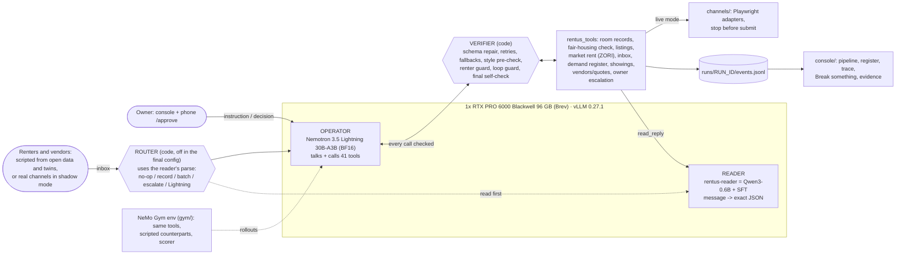

# Rentus Operator

A room-rental owner spends the day on the same loop: write the listing, post it to several sites, answer the same questions in English and Spanish, check that each renter can sign a one-year lease, has an exact move-in date, a phone number, a reason and a headcount, book showings, then field a tenant's leaking sink and call plumbers. Rentus Operator runs that leasing and operations desk with small open models on one GPU. **NVIDIA Nemotron 3.5 Lightning** (30B MoE, 3B active, served on **Red Hat vLLM**) is the one model that talks to the owner, renters and vendors and calls 41 tools: room records, a fair-housing check before anything is published, listings and channels, a demand register, showings, vendors and quotes, and owner escalations. A deterministic verifier (plain code, not a model) checks every call before and after it runs, repairs or retries what it can, falls back when a site or vendor fails, and refuses to let the operator claim something the world state does not show. A fine-tuned **Qwen3-0.6B reader** is one of the tools: it turns a renter's message into exact JSON, so the operator never guesses whether "early November" is a move-in date. The owner decides only what is his to decide (price, payment terms, anything that commits money), on his phone. A **NeMo Gym** environment with scripted renters and vendors, 7 scorer check types and a pre-registered held-out set built from real conversation shapes measures all of it.

## Track and bounties

- **Main track: Tool-Calling.** One small model selects and executes tools, handles errors and recovers from failures; the reader and the verifier are tools it calls, not other agents.
- **Bounties:** Best Use of NVIDIA Nemotron Lightning · Best Model Improvement with NVIDIA NeMo Gym · Best Use of Red Hat vLLM · NVIDIA Developer Champions Choice. Write-ups for each: [docs/submission.md](docs/submission.md).

## Quick start

```bash
git clone https://github.com/xvanov/red-hat-small-models-hack && cd red-hat-small-models-hack
cp .env.example .env          # fill in the variables below
scripts/setup.sh              # root .venv (uv, Python 3.12): tools, operator, console, channels + Chromium
scripts/setup.sh --gym        # optional: gym/.venv and gym/.venv-nemo (Python 3.13 + nemo-gym 0.6.0)
scripts/doctor.sh --quick     # tunnels, both model endpoints, every package's tests (drop --quick for browser tests)
scripts/demo.sh               # starts the tunnels if needed, then the console: http://localhost:8080
```

In the console click **▶ Demo run** (listing, two renters, a fault, a plumber job, a phone approval), or type `Appling Way room free Nov 1, $750, private bath` in the owner box. `scripts/demo.sh` also prints a tailnet-only phone URL (`http://<tailscale-ip>:8080/approve`) for approvals. With no GPU, `CONSOLE_FORCE_STUB=1 scripts/demo.sh` runs a rule-based rehearsal driver and the badge says **stub**.

## Architecture



| Part | Where | What it does |
|---|---|---|
| Operator | `operator/` | `rentus_operator.run()`: the agent loop over vLLM's OpenAI API. Reasoning arrives in its own field (`--reasoning-parser nemotron_v3`), tool calls via `--tool-call-parser qwen3_coder`. Final config: prompt v4 (`operator/prompts/system_v4.md`), concierge tool descriptions, renter guard with stand-down on owner-held threads, style pre-check, reasoning kept in history. |
| Verifier | `operator/rentus_operator/verifier.py` | Repairs broken JSON once, retries `RATE_LIMITED`/`TIMEOUT` with backoff, falls back to the next vendor or channel, refuses an identical call after a policy block, escalates after 3 repeats or at the step limit, and checks the final summary ("published on X", "booked") against the world. |
| Tools | `tools/` | Sandbox world with fault injection (timeout, rate limit, page changed, login required, malformed result). Business rules live here: price equals the room record, fair-housing check before publishing, at most 2 sentences and one question per renter message, no showing before the five-item gate is complete, no discount promised. |
| Reader | `reader/` | Second vLLM container on the same GPU. If unreachable, `read_reply` falls back to deterministic English/Spanish rules (the console badge says so). |
| Router | `operator/rentus_operator/router.py` | Optional: the reader reads each inbound message first and code decides whether Lightning is needed. Halves Lightning calls but loses some quality, so it is off in the final config (results below). |
| Channels | `channels/` | Playwright adapters (Marketplace, Roomies, Craigslist, PadSplit) that fill the form and stop before the final submit, with local mock copies of each site. `channels/pilot_shadow.py` reads the real Facebook Page inbox and drafts in shadow only. |
| Gym | `gym/` | NeMo Gym 0.6.0 resources server around the same tools, scripted renters/vendors, scorer `gym/rentus_env/verify.py`, task sets v1/v2 (synthetic) and v3 (twins of real threads). |
| Console | `console/` | FastAPI + SSE. One badge per model, the leasing pipeline, demand register and supply signals, a grouped live trace, and evidence tabs (Why trust it, Results, Performance, Real world). |

### Parameter budget (≤ 33B, summed across every generative model the running system loads)

| Model | Role | Params (model card) |
|---|---|---|
| [NVIDIA-Nemotron-3.5-Lightning-30B-A3B-BF16](https://huggingface.co/nvidia/NVIDIA-Nemotron-3.5-Lightning-30B-A3B-BF16) | operator (all talking and tool calls) | 30B total (3B active) |
| [Qwen3-0.6B](https://huggingface.co/Qwen/Qwen3-0.6B) + our SFT: [**xvanov/rentus-reader-qwen3-0.6b**](https://huggingface.co/xvanov/rentus-reader-qwen3-0.6b) | reader tool; also the router's parser | 0.6B |
| **Total** | | **30.6B ≤ 33B** |

The verifier, router logic, scripted renters/vendors and compliance checks are code, not models. No speculative-decoding draft model is loaded (DSpark/DFlash would count; Lightning's built-in MTP was tried and turned off, see limitations). Hugging Face's raw weight counts are 31.58B (Lightning) and 0.75B (Qwen3-0.6B with tied embeddings), 32.3B together, still under 33B. Models used only for evaluation (the Claude Opus 5.5 reference, the model-played renter) are not part of the running system; the organizers confirmed those do not count (`docs/hackathon/updates.md`, 2026-10-17 12:50 ET).

## How to reproduce

1. **Env.** `cp .env.example .env` (gitignored, never committed):

   | Variable | Value |
   |---|---|
   | `OPERATOR_BASE_URL` | `http://localhost:8000/v1` (SSH tunnel to vLLM on the GPU) |
   | `OPERATOR_MODEL` | `nemotron-3.5-lightning` |
   | `OPERATOR_API_KEY` | the vLLM `--api-key` (`serving/rebuild.sh` generates one if empty) |
   | `READER_BASE_URL` | `http://localhost:8011/v1` (tunnel to the reader container) |
   | `READER_MODEL` | `rentus-reader` |
   | `READER_API_KEY` | same as `OPERATOR_API_KEY` |
   | `BREV_API_KEY` | Brev CLI key; `serving/tunnel.sh` mints its SSH cert with it |

2. **GPU, one command.** `serving/rebuild.sh` creates the Brev instance (`massedcompute_RTXPro6000`: 1x RTX PRO 6000 Blackwell 96 GB, $2.63/hr) if needed, installs Docker, starts `vllm/vllm-openai:v0.27.1` with Lightning BF16 (flags in `serving/start_vllm.sh`, frozen in `serving/FROZEN.json`), pulls the reader from Hugging Face and serves it on the same card (`reader/serve_reader.sh`, 12% of GPU memory), opens both tunnels and runs `serving/smoke_test.py`. `serving/rebuild.sh --dry-run` prints every step. Idempotent: rerun after a failure.

3. **Console.** `scripts/demo.sh`, then `.venv/bin/python scripts/console_verify.py all` drives every console path on the live models with Playwright and writes screenshots to `docs/img/`.

4. **Evaluation** (pre-registered commands from `gym/confirmatory_v3.json` and `docs/eval-protocol.md` Amendments 6 to 8; run from a clean worktree at the freeze commit):

   ```bash
   V3=gym/tasks/v3/heldout.jsonl; OC='{"prompt_version":"v4","tool_descriptions":"concierge","guard_stand_down":true}'
   gym/.venv/bin/python gym/run_seeds.py --variant base --tasks-file $V3 --seeds 1,2,3,4,5 --prefix v3-heldout-baseline --workers 5
   gym/.venv/bin/python gym/run_seeds.py --variant guard+prompt3+style+rhist+readermodel --operator-config "$OC" \
       --tasks-file $V3 --seeds 1,2,3,4,5 --prefix v3-heldout-final --workers 5
   gym/.venv/bin/python gym/run_seeds.py --variant guard+prompt3+style+rhist+readermodel+router --operator-config "$OC" \
       --tasks-file $V3 --seeds 1,2,3,4,5 --prefix v3-heldout-final-router --workers 5
   OPERATOR_CONFIG="$OC" scripts/frontier_ref.sh $V3 1,2          # reference only: Claude Opus 5.5 via local Claude Code
   # reader H2 on the 90 owner-labeled messages (Amendment 7)
   python3 reader/eval.py --backend endpoint --base-url http://127.0.0.1:8001/v1 --model rentus-reader \
       --rows-file data/published/owner_gold_combined.jsonl --label finetuned-twin
   python3 reader/eval.py --backend endpoint --base-url http://127.0.0.1:8000/v1 --model nemotron-3.5-lightning --no-thinking \
       --concurrency 8 --rows-file data/published/owner_gold_combined.jsonl --label lightning-twin
   gym/.venv-frontier/bin/python reader/eval.py --backend claude_cli --model claude-opus-5-5 \
       --rows-file data/published/owner_gold_combined.jsonl --label frontier-twin --concurrency 3
   # statistics (no model calls), then fill this README
   gym/.venv/bin/python gym/stats.py plan gym/confirmatory_v3.json --check
   gym/.venv/bin/python gym/h2_combined.py --md --json gym/results/v3-confirmatory.json
   gym/.venv/bin/python gym/floors.py --tasks-file $V3
   gym/.venv/bin/python scripts/fill_results.py --write
   ```

   Exploratory sets: `--tasks-version v2 --split heldout` (v2) and the Messenger conformance suite (`gym/conformance/`). Serving bench: `docs/vllm.md` §Reproduce.

## Results

Every number below comes from a committed file. Values in `{{...}}` are filled by `scripts/fill_results.py` from the confirmatory result files once the runs finish; until then they are placeholders, not results.

### Confirmatory: v3 held-out (46 leasing tasks, twins of real threads, pre-registered)

Model: Lightning BF16 on vLLM, temperature 0.2. Analyzed: {{V3_SEEDS}}. Pass rate = share of tasks where every check passed (95% Wilson); mean reward = share of checks passed (95% bootstrap over tasks); pass^k = passes in every run.

| config | pass rate (95% CI) | mean reward (95% CI) | pass in every run | Lightning calls / task |
|---|---|---|---|---|
| Baseline (prompt v1, verbose tools, rule-based reader) | {{V3_BASELINE_PASS}} | {{V3_BASELINE_REWARD}} | {{V3_BASELINE_PASSALL}} | {{V3_BASELINE_CALLS}} |
| **Final** (prompt v4, concierge tools, renter guard + stand-down, style pre-check, reasoning history, fine-tuned reader) | {{V3_FINAL_PASS}} | {{V3_FINAL_REWARD}} | {{V3_FINAL_PASSALL}} | {{V3_FINAL_CALLS}} |
| Final + router | {{V3_ROUTER_PASS}} | {{V3_ROUTER_REWARD}} | {{V3_ROUTER_PASSALL}} | {{V3_ROUTER_CALLS}} |
| Reference: Claude Opus 5.5, same harness and reader | {{V3_FRONTIER_PASS}} | {{V3_FRONTIER_REWARD}} | {{V3_FRONTIER_PASSALL}} | {{V3_FRONTIER_CALLS}} |

Floors on the same 46 tasks (`gym/results/v3-floors.json`): do-nothing 0.612, greet-only **0.841**, escalate-all 0.624, mark-lost 0.630 mean reward, and all four pass 0 tasks. A greeting alone earns 0.84, so read reward next to pass rate, never alone.

**Pre-registered hypotheses** (one-sided, Holm over a fixed family of 5 at familywise α = 0.025; an untested hypothesis stays in the family with p = 1):

- **H1, final beats baseline:** {{H1_RESULT}}. Secondary: two-sided 95% paired CI {{H1_CI}}; Δ pass rate {{H1_DPASS}}.
- **H2a, the 0.6B reader beats Lightning at reading renter messages** (90 owner-labeled messages, blind owner gold, exact match with reason scored on status): {{H2A_RESULT}}.
- **H2b, the 0.6B reader beats Claude Opus 5.5** (same rows): {{H2B_RESULT}}.
- **H3, the router cuts Lightning calls without losing more than 0.05 reward:** (i) {{H3I_RESULT}}; (ii) {{H3II_RESULT}}. Decision: {{H3_DECISION}}.
- **H4, the local system is within 0.05 reward of Claude Opus 5.5 on the same harness:** {{H4_RESULT}}. Secondary: two-sided 95% paired CI {{H4_CI}}. A non-rejection means "not shown", not "worse".

{{HOLM_TABLE}}

Secondary H2 (uncorrected, pre-declared): real-twin rows only, reader vs Lightning {{H2A_REAL61}}; reader vs Opus {{H2B_REAL61}}. Informative rows only (a gate field is not "absent"): vs Lightning {{H2A_INFORMATIVE}}; vs Opus {{H2B_INFORMATIVE}}. Exact match on all 90: fine-tuned {{READER_EM_FINETUNED}}, Lightning {{READER_EM_LIGHTNING}}, Opus {{READER_EM_FRONTIER}}.

Scorer validation (owner grades 40 random transcripts blind, protocol A5): {{KAPPA_RESULT}}.

Caveats reported with every v3 number: five owner sign-offs were missing at freeze (Amendment 6), so v3 is "synthetic, realism not confirmed", the task-deciding labels were not owner-checked, and the showing-required check rests on a 45-day window the owner has not approved. The scoring rules come from the owner's Oct 4 to 18 sessions, inside the held-out time window (the rules, not the threads).

### Exploratory: v2 held-out (33 synthetic tasks, contaminated, 3 seeds each; `docs/results.md`)

| config | pass rate (95% CI) | mean reward (95% CI) | Lightning calls / task |
|---|---|---|---|
| Baseline | 12.1% (5 to 27%) | 0.570 (0.493 to 0.648) | 8.4 |
| Final (prompt v3 generation) | 45.5% (30 to 62%) | 0.929 (0.911 to 0.945) | 20.9 |
| Final + router | 46.5% (31 to 63%) | 0.876 (0.834 to 0.914) | 11.2 |
| Final on NeMo Gym `simple_agent` (2 seeds) | 54.5% (38 to 70%) | 0.887 (0.842 to 0.930) | |

Final vs baseline +0.359 reward (95% CI +0.281 to +0.436), 22 tasks better and 2 worse. Router vs final −0.053 (−0.093 to −0.016). v2 overlaps the v1 held-out set that was run about 15 times during development, so it is a regression check only.

### Conformance to the owner's rules (`gym/results/conformance/`, development check, one run per item)

61 testable behaviors from the concierge spec checklist (`docs/spec/concierge.md` §9), each a scripted Messenger scenario:

| config | items passed |
|---|---|
| Reference player (privileged code, proves each item is passable) | 60 / 61 |
| Final with prompt v3 (before the v4 work) | 28 / 61 |
| Prompt v4 + concierge tools, first version | 33 / 61 |
| **Prompt v4 + concierge tools + guard stand-down (the confirmatory final)** | **50 / 61** |

These scenarios were written alongside the system and the v4 changes were made against them, so this is a development signal, not a held-out result.

### Reader on the synthetic test (`reader/README.md`, `docs/results.md`)

| System | Exact match, 1,419 rows | Exact match, same 400-row sample | Vague-date trap ↓ (1,419 rows) | p50 latency |
|---|---|---|---|---|
| Rule-based fallback | 0.575 | 0.555 | 0.012 | |
| Qwen3-0.6B base | 0.000 | 0.000 | 0.082 | |
| **rentus-reader (Qwen3-0.6B + SFT)** | **0.791** | **0.813** | 0.012 | 0.58 s (local) |
| Lightning 30B, prompted | 0.106 | 0.123 | 0.365 | 2.7 s |
| Claude Opus 5.5, prompted (reference) | | 0.738 (Zen) / 0.720 (Claude Code) | | 3.3 s |

The synthetic test is partly in-distribution (template overlap disclosed in `docs/results.md`), which is why the confirmatory H2 uses owner-labeled messages instead.

### vLLM serving (`docs/vllm.md`, `serving/results/serve_bench.jsonl`)

| Measurement | Result |
|---|---|
| Prefix caching on vs off, real 6k-token operator prompt + tool schemas (NVFP4, paired via `cache_salt`) | +27% throughput at N=8, **+76% at N=32, +97% at N=64**; time to first token −50 to −64% |
| Reasoning off vs on for routine tool turns (N=32) | 6.9 → **13.2 turns/s**, p95 8.1 s → 2.6 s, every turn still a tool call |
| Throughput sweep, NVFP4 | 219 tok/s at N=1 → 1,412 at N=32 → 1,755 at N=128; 0 errors in 1,650 requests |
| Two models on one card | reader p95 under 0.47 s at every operator load level, 0 errors in 507 probes |
| NVFP4 → BF16 stability | NVFP4 crashed under ~16 to 48 concurrent agent requests (`misaligned address` / illegal memory access); BF16 ran 2,567 requests in 15.5 min with 0 errors. Cost: −38% decode throughput at N=32 (1,412 → 880 tok/s), TTFT 2.2 → 1.0 s |
| H5, pre-registered 3-repetition caching bench on the frozen BF16 server | {{H5_RESULT}} |

## Datasets, provenance and licenses

Full details, transformations and rebuild commands: [docs/data-provenance.md](docs/data-provenance.md). License table: [LICENSES.md](LICENSES.md). No real tenant or renter text is published or sent to any third-party API.

| Dataset | License | Used for |
|---|---|---|
| [Google Schema-Guided Dialogue](https://github.com/google-research-datasets/dstc8-schema-guided-dialogue), Homes services (pinned commit) | CC BY-SA 4.0 | 2,000 relabeled renter turns in the reader set |
| [UCI Apartment for Rent Classified](https://archive.ics.uci.edu/dataset/555/apartment+for+rent+classified) | CC BY 4.0 | per-bedroom base rents, Durham / Raleigh / Chapel Hill |
| [Zillow Observed Rent Index (ZORI)](https://www.zillow.com/research/data/) | Zillow terms, free with attribution | 2019 → 2026 rent growth; `get_market_rent` |
| [Inside Airbnb, Asheville NC](https://insideairbnb.com/get-the-data/) | CC BY 4.0 | amenity mix of sandbox rooms |
| [nvidia/Nemotron-Personas-USA](https://huggingface.co/datasets/nvidia/Nemotron-Personas-USA) | CC BY 4.0 | the invented renter in every twin |
| [nvidia/When2Call](https://huggingface.co/datasets/nvidia/When2Call), [Nemotron-RL-Agentic-Conversational-Tool-Use-Pivot-v1](https://huggingface.co/datasets/nvidia/Nemotron-RL-Agentic-Conversational-Tool-Use-Pivot-v1) | CC BY 4.0 | references for call-vs-ask design and Gym trajectories |
| 24 CFR 100.75 + HUD advertising guidance | US government works | fair-housing rules (`tools/rentus_tools/impl/compliance_rules.md`) |
| **Made here:** reader set (14,000 train rows, `data/build_reader_set.py`, templates, no LLM) | CC BY-SA 4.0 | reader fine-tune; `data/published/reader/` |
| **Made here:** twins of the owner's own leasing threads (`data/twins/`: label skeleton only, rewritten by Lightning with a Nemotron persona, re-verified, privacy-filtered by n-gram and embedding similarity) | CC BY 4.0 | v3 Gym tasks, twin reader test; `data/published/twins/`, `gym/tasks/v3/` |
| **Made here:** owner blind labels (61 real-twin + 29 pilot messages) | CC BY 4.0 | H2 gold; `data/published/owner_gold_combined.jsonl` |
| **Made here:** sandbox inventory, Gym tasks v1/v2, owner style statistics (numbers only) | CC BY 4.0 | sandbox world, development tasks, prompt tone |

The owner's private threads were processed only on this machine and the rented GPU over an encrypted SSH tunnel, never sent to a third-party model API and never committed. Code is Apache-2.0. All code was written during the event (first commit Oct 17, 2026 11:10 ET); third-party libraries were public 2+ weeks before the event (root `.venv` installs with `--exclude-newer 2026-10-03`; vLLM 0.27.1 and nemo-gym 0.6.0 are dated in their READMEs). Salesforce xLAM was excluded (research-only license).

## Methodology

The evaluation was pre-registered in [docs/eval-protocol.md](docs/eval-protocol.md) at about 04:30 ET on Oct 18, before any confirmatory run, and attacked by two rounds of independent review (`docs/reviews/`: statistics, leakage, scorer and privacy, then a round-2 gate list). The commit history is the timestamp. What it fixed in advance: the hypotheses, the one-sided tests, the Holm family (m = 5, α = 0.025), the non-inferiority margin (0.05 reward), 5 seeds per config, the rerun and void rules, and that nobody reads v3 held-out transcripts until every run is done. Freezing is enforced in code: `scripts/freeze.py` hashes every frozen artifact into `docs/freeze-manifest.json`, and `gym/stats.py plan` refuses any run made on dirty frozen paths or off the freeze commit.

Eight amendments, all logged with a time and reason:

1. **Review round 1** (~04:00): one-sided tests and a fixed family; simulated power instead of a rule of thumb (the old "well powered" sentence was withdrawn); H2 gold must come from the owner, not from a model under test; scorer fixes so trivial agents cannot pass; checks the send guard makes impossible to fail are reported apart; the v2 set was demoted after we found it shares 31 of 33 tasks with the v1 held-out set we had tuned against.
2. **Review round 2** (~05:00): run names, void rules and frozen paths enforced in code; serving config frozen (BF16, see limitations); a blind labeler that never shows the owner any model's label.
3. **Label adjudication** (~04:50): the audit of the owner's labels is rule-based only; no model proposes changes to gold.
4. **Pilot set** (~05:05): the owner's labels on a 29-message practice set are kept, reported separately.
5. **Smaller H2 sample** (~05:20): the owner could label about 71 messages before the cut-off, not 150. Power was recomputed: only differences of about 15 to 20 points are detectable.
6. **Final config and frontier repeats** (~06:20): the final config was chosen on development data only (prompt v4 + concierge tools + guard stand-down); the frontier gets 2 repeats, not 5. Five owner sign-offs were missing at freeze; we froze anyway and recorded the gaps, with their consequences stated next to every v3 result.
7. **H2 on all 90 owner-labeled messages** (~06:40): 57 of the 61 real-twin messages carried no gate information (small talk and logistics), so exact match on them says little. The primary H2 analysis moved to 61 + 29 messages, stratified by source. This change came after the freeze and after the owner saw the messages' content (no model had been scored on them), so the original real-twin-only analysis is always shown next to it.
8. **Re-freeze on the complete set** (~06:35), the incident: the first freeze used a partial 22-task cut that the twin pipeline had written under a time limit. Runs on it had started and were stopped after a few rollouts of seed 1, before anyone opened any score, row or transcript; they are kept on disk as `_superseded-22task-*` and never reported. The complete 46-task set was frozen and every config restarted. A post-freeze note records two more infrastructure events: a later pipeline step overwrote the reader test file the owner had labeled (H2 never reads it: the owner-gold rows carry their own input, and we verified all 61 against the original bytes), and the first two frontier repeats were voided because every rollout hit a Claude Code subscription rate limit, then relaunched. A stopping rule fixed at 08:15 ET decides how many seeds count, independent of any score.

What this does not fix: v3 is small (46 tasks; H1 is powered only for a true gain of about +0.09 reward), it is one owner's business, and the frontier ran on a harness tuned for Lightning.

## Known limitations and next steps

- **Small held-out sets.** 46 leasing tasks and 90 owner-labeled messages. Per-category numbers are anecdotes; H3 and H4 can only succeed if the true difference is near zero or positive. Ops and vendor tasks on v3 are 5 experimental tasks, never pooled.
- **Sandbox, not live channels.** The scored runs use the sandbox world and mock sites. Real-platform adapters stop before the final submit button. One real listing exists: the operator wrote the Appling Way post on the Rentus Homes Facebook Page and the owner published it unedited ([permalink](https://www.facebook.com/122140650357237994/posts/122140650345237994), decision D20). Its inbox runs in shadow mode: the operator drafts, the owner sends. Nothing reaches a real person without the owner's click.
- **Scripted renters.** Counterparts answer by keyword; an unusual question can get no reply. Model-played renters exist but are secondary and come from the operator's own model family.
- **NVFP4 and MTP were unstable, so we serve BF16.** NVFP4 crashed the engine under concurrent agent load on vLLM 0.27.1 with this GPU (Marlin W4A16 path on SM120); BF16 ran clean at about 38% lower decode throughput. Built-in MTP (free under the budget) accepted about 3 tokens per step but crashed at 4 concurrent requests. The serving numbers above that say NVFP4 were measured before the switch.
- **Router trade-off.** The router halves Lightning calls and input tokens but lost 0.053 reward on v2 (mostly recorded move-in dates), so it is off in the final config; v3 tests it again (H3).
- **Leasing-heavy realistic set.** The real threads available were mostly leasing; operations behavior (maintenance, rent, vendors) is covered by synthetic tasks and the conformance suite only.
- **Scorer limits.** Phrase lists and a keyword "asked" classifier can be fooled by paraphrase; a greeting alone earns 0.84 reward. The owner's blind grading (κ) decides whether pass rates may be called "correct behavior" or only "scorer-defined".
- **Next:** live channels with the owner logged in, timed follow-ups (the sandbox has no clock, so timing rules are unscored), a generation-level watchdog, an operator LoRA from Gym rollouts, and integration with the owner's existing tools after the event.

## Team

**Rentus: Kalin Ivanov**, solo (product, architecture, every decision; GitHub [@xvanov](https://github.com/xvanov)). Built with AI coding agents (Claude Code) running one workstream each: serving, operator, tools, gym, data and twins, reader, console, channels, evaluation. `docs/DECISIONS.md` records who decided what.

## Links

- Fine-tuned reader: [huggingface.co/xvanov/rentus-reader-qwen3-0.6b](https://huggingface.co/xvanov/rentus-reader-qwen3-0.6b) (CC BY-SA 4.0; also GitHub release `reader-v1`)
- Live listing written by the operator: [Rentus Homes Facebook Page post](https://www.facebook.com/122140650357237994/posts/122140650345237994)
- Demo video: {{VIDEO_URL}}
- Bounty write-ups and submission answers: [docs/submission.md](docs/submission.md) · serving: [docs/vllm.md](docs/vllm.md) · Gym: [gym/README.md](gym/README.md) · full results: [docs/results.md](docs/results.md) · protocol: [docs/eval-protocol.md](docs/eval-protocol.md)
