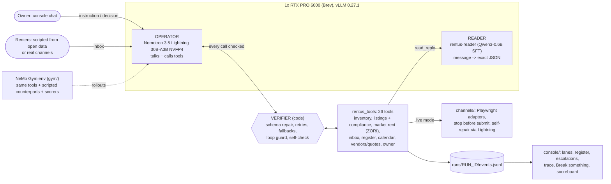
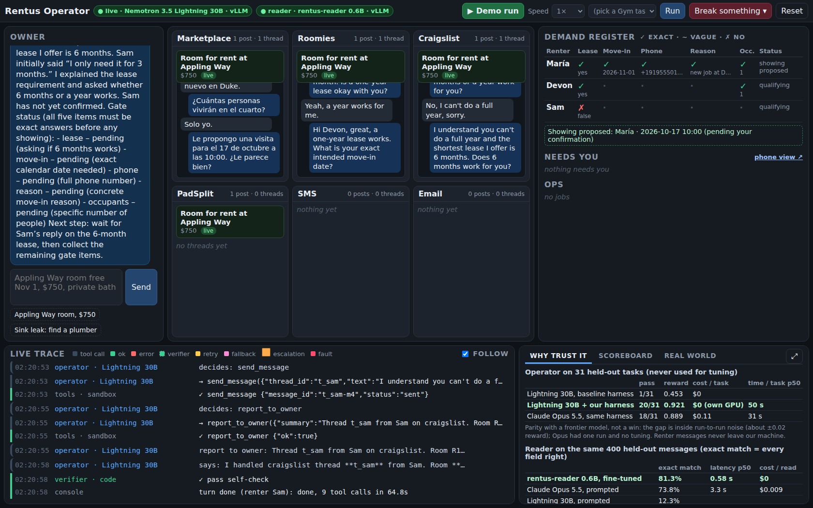
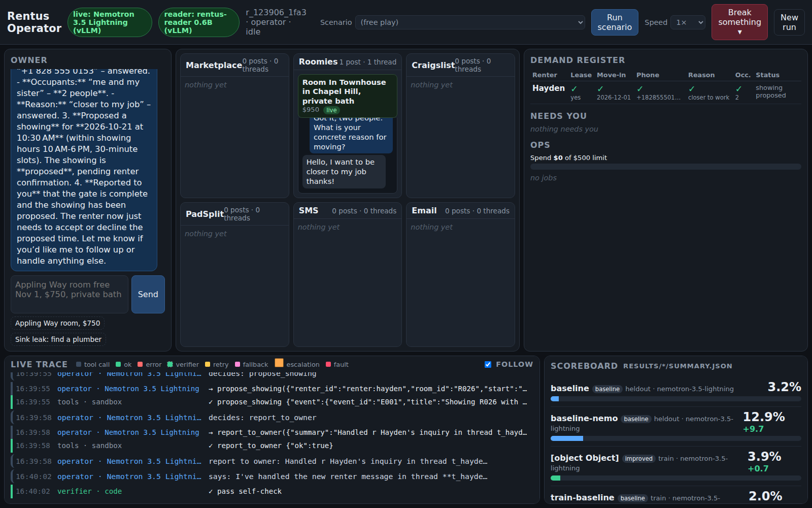

# Rentus Operator

Rentus Operator runs the leasing loop for a small room-rental business from one sentence. The owner types "the Appling Way room is free Nov 1, $750, private bath". **NVIDIA Nemotron 3.5 Lightning** (30B MoE, served on **vLLM**) then checks the room record, runs a fair-housing check on the listing, creates the listing and publishes it to the channels. It answers renters, qualifies each one against a strict five-item gate (one-year lease, exact move-in date, phone, reason, occupants), records them in a demand register, proposes showings, and escalates to the owner only what needs a decision. The same operator handles property operations too: find a plumber, collect quotes, book the cheapest one under the owner's spending limit. Lightning is the one model that talks and calls 26 tools. A deterministic verifier (plain code, not a model) checks every call before and after it runs and handles retries, fallbacks and a final self-check of the operator's claims. A fine-tuned **Qwen3-0.6B reader** is one of those tools: it turns a renter's message into exact JSON, so the operator never has to judge on its own whether "next month" is a move-in date. A **NeMo Gym** environment (82 tasks with scripted renters and vendors, 7 scorer check types, a held-out split) measures all of it.

## Track and bounties

- **Main track: Tool-Calling.** A single small model that selects and executes tools, handles errors, and recovers from failures. Fine-Tuned & Specialized (the reader) is the fallback track.
- **Bounties:** Best Use of NVIDIA Nemotron Lightning, Best Model Improvement with NVIDIA NeMo Gym, Best Use of Red Hat vLLM, NVIDIA Developer Champions Choice.

## Quick start

```bash
git clone <this repo> && cd red-hat-small-models-hack
cp .env.example .env          # fill in OPERATOR_API_KEY (and BREV_API_KEY for the tunnel)
scripts/setup.sh              # root .venv (uv, Python 3.12): tools, operator, console, channels + Chromium
scripts/setup.sh --gym        # optional: gym/.venv-nemo (Python 3.13 + nemo-gym 0.6.0) and gym/.venv
scripts/doctor.sh --quick     # tunnels, both endpoints, every package's tests (drop --quick to add the browser tests)
scripts/demo.sh               # starts the tunnels if needed, then the console; prints http://localhost:8080
```

In the console, type `Appling Way room free Nov 1, $750, private bath`, or pick a gym scenario and click **Run scenario**. With no GPU, `CONSOLE_FORCE_STUB=1 scripts/demo.sh` runs a rule-based rehearsal driver, and the badge says "stub".

The root `.venv` is the one project environment. The gym keeps its own Python 3.13 env (`gym/setup_nemo_gym.sh`), and the reader keeps its own training env (`reader/requirements-train.txt`, on the GPU box). Scripts always call `.venv/bin/python` by path.

## Architecture



- **Operator** (`operator/`): `rentus_operator.run()` is the agent loop over vLLM's OpenAI-compatible API. One model holds the conversation and makes the tool calls in the same turn. Reasoning arrives in a separate field (`--reasoning-parser nemotron_v3`), and tool calls are parsed by `--tool-call-parser qwen3_coder`.
- **Verifier** (`operator/rentus_operator/verifier.py`): repairs trivially broken JSON once, retries `RATE_LIMITED`/`TIMEOUT` with backoff, falls back to the next vendor or channel, refuses an identical call after a policy block, escalates after 3 repeats or at the step limit, and checks the final summary ("published on X", "booked") against the world state.
- **Tools** (`tools/`): a sandbox world with fault injection (timeout, rate limit, page changed, login required, malformed result). The tools enforce the business rules: price must equal the room record, the fair-housing check runs before publishing, renter messages are at most 2 sentences with one question, and no showing is proposed until the gate is complete.
- **Reader** (`reader/`): a second vLLM container on the same GPU. If it's unreachable, `read_reply` falls back to deterministic English/Spanish rules.
- **Channels** (`channels/`): Playwright adapters for marketplace, Roomies, Craigslist and PadSplit. They fill the whole form and stop before the final submit button, with local mock copies of each site. When a selector breaks, Lightning proposes a fix and code validates it on the page.
- **Gym** (`gym/`): a NeMo Gym 0.6.0 resources server around the same tools, with 51 train and 31 held-out tasks and a scorer in `gym/rentus_env/verify.py`.
- **Console** (`console/`): FastAPI + SSE. It shows one badge per model ("live: Nemotron 3.5 Lightning (vLLM)", "reader: rentus-reader 0.6B (vLLM)" or "reader: rules fallback").

### Parameter budget (≤ 33B, summed across every generative model)

| Model | Role | Params (model card) |
|---|---|---|
| [NVIDIA-Nemotron-3.5-Lightning-30B-A3B](https://huggingface.co/nvidia/NVIDIA-Nemotron-3.5-Lightning-30B-A3B-BF16) (served as NVFP4) | operator, selector repair, Gym policy | 30B total (3B active) |
| [Qwen3-0.6B](https://huggingface.co/Qwen/Qwen3-0.6B) + our SFT (`rentus-reader`) | reader tool | 0.6B |
| **Total** | | **30.6B ≤ 33B** |

The verifier, the scripted renters/vendors and the compliance checks are code, not models. We use no separate speculative-decoding draft (DSpark/DFlash would count toward the budget). Hugging Face's raw weight counts are 31.58B (Lightning) and 0.75B (Qwen3-0.6B with tied embeddings), 32.3B in total, which is still under 33B.

## How to reproduce the demo

1. **Env** (`.env.example` → `.env`, never committed):

   | Variable | Value |
   |---|---|
   | `OPERATOR_BASE_URL` | `http://localhost:8000/v1` (tunnel to vLLM) |
   | `OPERATOR_MODEL` | `nemotron-3.5-lightning` |
   | `OPERATOR_API_KEY` | the vLLM `--api-key` you started the server with |
   | `READER_BASE_URL` | `http://localhost:8011/v1` (tunnel to the reader container) |
   | `READER_MODEL` | `rentus-reader` |
   | `READER_API_KEY` | same as `OPERATOR_API_KEY` |
   | `BREV_API_KEY` | Brev CLI key; `serving/tunnel.sh` mints its ssh cert with it |

2. **GPU** (Brev `massedcompute_RTXPro6000`: 1x RTX PRO 6000 Blackwell 96 GB, $2.63/hr, instance `rentus-operator`):

   ```bash
   brev create rentus-operator --gpu massedcompute_RTXPro6000
   printf 'VLLM_API_KEY=%s\n' "$OPERATOR_API_KEY" | ssh rentus-operator 'umask 077; mkdir -p ~/serving; cat > ~/serving/vllm.env'
   scp serving/start_vllm.sh rentus-operator:serving/ && ssh rentus-operator 'bash ~/serving/start_vllm.sh'
   # vllm/vllm-openai:v0.27.1, nvidia/NVIDIA-Nemotron-3.5-Lightning-30B-A3B-NVFP4, --max-model-len 65536
   # --gpu-memory-utilization 0.80 --max-num-seqs 64 --enable-prefix-caching --async-scheduling
   # --reasoning-parser nemotron_v3 --tool-call-parser qwen3_coder --enable-auto-tool-choice (+ mamba cache flags)
   MODEL=/ckpt/rentus-reader bash ~/rentus/reader/serve_reader.sh    # on the instance: reader on 127.0.0.1:8001, 12% GPU
   ```

   Train the reader first (`reader/README.md` §Reproduce), or serve `Qwen/Qwen3-0.6B` to see the base model fail.

3. **Tunnels and console** (laptop):

   ```bash
   serving/tunnel.sh                          # localhost:8000 -> instance:8000 (operator)
   LPORT=8011 RPORT=8001 serving/tunnel.sh    # localhost:8011 -> instance:8001 (reader)
   scripts/demo.sh                            # or let demo.sh start both tunnels
   .venv/bin/python scripts/console_run.py --goal 'Appling Way room free Nov 1, $750, private bath' --out docs/img/console-listing.png
   .venv/bin/python scripts/console_run.py --scenario lease-full-heldout-001 --out docs/img/console-leasing.png
   ```

4. **Scoring** (`gym/README.md`): `gym/.venv/bin/python gym/run_eval.py --split heldout --run-name baseline [--via nemo]`, then `gym/ablate.py` for one-knob-at-a-time variants.

### Live console runs (2026-10-17, Lightning + reader on vLLM)

| Run | What happened |
|---|---|
|  | Owner instruction "Appling Way room free Nov 1, $750, private bath": `list_rooms` → `get_room` → `check_listing_compliance` → `create_listing` → `publish_listing` on marketplace, roomies and craigslist → `report_to_owner`. Listing cards show in three lanes. Three scripted renters arrive. The operator qualifies María in Spanish (vague "a fines de mes" sent back for an exact date, then 2026-11-01), and every gate item shows a tick. The verifier blocked four messages that broke the style rules, and the operator rewrote them. The showing ended up escalated: see limitations. |
|  | Gym held-out task `lease-full-heldout-001`: the scripted renter Hayden passes all five gate items (lease yes, move-in 2026-12-01, phone, reason "closer to work", 2 occupants), and a showing is proposed inside showing hours. All 12 `read_reply` calls across both runs went to the served reader (`backend: model`). |

## Results

Full write-up: [docs/results.md](docs/results.md) (*pending: the gym workstream writes it; it may not exist yet*).

### Reader (held-out test, 1,419 rows; from `reader/README.md`)

| System | Exact match | JSON valid | Lease | Move-in | Phone | Occupants | Reason | Intent F1 | Language | Vague-date trap ↓ |
|---|---|---|---|---|---|---|---|---|---|---|
| Deterministic regex fallback | 0.575 | 1.000 | 0.886 | 0.994 | 0.998 | 0.977 | 0.877 | 0.772 | 0.998 | 0.012 |
| Qwen3-0.6B base, same prompt | 0.000 | 0.910 | 0.106 | 0.023 | 0.011 | 0.028 | 0.004 | 0.105 | 0.699 | 0.082 |
| **rentus-reader (Qwen3-0.6B + SFT)** | **0.791** | 1.000 | 0.991 | 0.977 | 0.997 | 0.999 | 0.865 | 0.951 | 1.000 | 0.012 |
| Nemotron 3.5 Lightning, prompted | 0.106 | 0.985 | 0.569 | 0.554 | 0.827 | 0.721 | 0.534 | 0.450 | 0.944 | 0.365 |

Latency p50: reader 0.58 s per call at concurrency 32, Lightning 2.7 s at concurrency 8. Prompted Lightning treats over a third of vague move-in dates as exact. That failure is why the reader exists.

**Download:** the fine-tuned reader is GitHub release [`reader-v1`](https://github.com/xvanov/red-hat-small-models-hack/releases/tag/reader-v1) (CC BY-SA 4.0, 949 MB tar.gz + `SHA256SUMS`). Model card: [reader/MODEL_CARD.md](reader/MODEL_CARD.md). Serving: [reader/README.md#download](reader/README.md#download).

### NeMo Gym (held-out, 31 tasks; `gym/results/*/summary.json`)

| Run | Harness | Pass rate | Mean reward | Leasing | Listing | Ops | Recovery (mean reward) |
|---|---|---|---|---|---|---|---|
| Baseline, local runner | `rentus_operator` (prompt v1, verbose tools, verifier on, reader on) | 3.2% (1/31) | 0.452 | 0.284 | 0.833 | 0.816 | 0.460 |
| Baseline, NeMo Gym 0.6.0 rollouts | NeMo `simple_agent` | 12.9% (4/31) | 0.646 | 0.648 | 0.729 | 0.696 | 0.536 |
| Improved (prompt v2, tool descriptions v2, renter guard; one knob at a time) | `gym/ablate.py` | *pending* | *pending* | | | | |

The improvement candidates are committed as separate knobs (`bdc8ade`), but their held-out numbers are not in yet.

### vLLM (Lightning NVFP4 on 1x RTX PRO 6000; from `serving/bench-results.md`)

Shared ~3.9k-token prompt prefix, 256 output tokens, thinking off, measured through the SSH tunnel on a quiet server (11:37 / 11:41 ET):

| Concurrency | Prefix cache ON: tok/s, p50 latency, p50 TTFT | Prefix cache OFF: tok/s, p50 latency, p50 TTFT |
|---|---|---|
| 1 | 254, 1.00 s, 163 ms | 243, 1.01 s, 208 ms |
| 4 | 614, 1.66 s, 308 ms | 579, 1.77 s, 482 ms |
| 16 | 1286, 3.17 s, 768 ms | 878, 4.64 s, 1347 ms |
| 32 | 1764, 4.61 s, 1134 ms | 1247, 6.44 s, 2068 ms |

At 16–32 concurrent requests, prefix caching gives +41–46% throughput and roughly halves time to first token. Caveat: other workstreams may have added load to the OFF run, and a clean re-run on an idle server is *pending*. Under real team load (gym rollouts plus reader training on the same GPU), a soak of 160 requests at concurrency 16 finished with 0 errors. Smoke tests: tool-call JSON came back valid in thinking-on and thinking-off modes. Tool-call parse success rate over a Gym run: *pending*.

**Why Lightning, and how we tuned it:** it's a 30B model with only 3B active per token (a hybrid Mamba/MoE design), so it's fast enough to hold 30+ concurrent agent rollouts on one GPU, while the big total size keeps its tool selection reliable. It's served as NVFP4 (about 19 GB of weights), which leaves room on the same card for the reader and for training. We turn thinking off for routine tool turns, and every session shares one system prompt, which prefix caching turned into a ~76% cache hit rate under gym load (vLLM engine log, 12:15 ET).

## Datasets and provenance

Full details, transformations and rebuild commands: [docs/data-provenance.md](docs/data-provenance.md). No real tenant or renter data is used anywhere.

| Dataset | License | Used for |
|---|---|---|
| [Google Schema-Guided Dialogue](https://github.com/google-research-datasets/dstc8-schema-guided-dialogue), Homes services | CC BY-SA 4.0 | 2,000 relabelled renter turns in the reader set (so the reader set and weights are CC BY-SA 4.0) |
| [UCI Apartment for Rent Classified](https://archive.ics.uci.edu/dataset/555/apartment+for+rent+classified) | CC BY 4.0 | per-bedroom base rents for Durham, Raleigh, Chapel Hill |
| [Zillow Observed Rent Index (ZORI)](https://www.zillow.com/research/data/), ZIP level | Zillow Terms of Use, free with attribution (not CC) | 2019→2026 rent growth; `get_market_rent` tool |
| [Inside Airbnb, Asheville NC](https://insideairbnb.com/get-the-data/) | CC BY 4.0 | amenity mix, private-bath and own-entrance rates of the sandbox rooms |
| [nvidia/When2Call](https://huggingface.co/datasets/nvidia/When2Call) | CC BY 4.0 | reference for call-vs-ask-vs-refuse in prompt and task design |
| [nvidia/Nemotron-RL-Agentic-Conversational-Tool-Use-Pivot-v1](https://huggingface.co/datasets/nvidia/Nemotron-RL-Agentic-Conversational-Tool-Use-Pivot-v1) | CC BY 4.0 | reference trajectories for the Gym environment |
| 24 CFR 100.75 + HUD advertising guidance | US government works | fair-housing compliance rules (`tools/rentus_tools/impl/compliance_rules.md`) |
| **Synthetic, made here:** reader set (12,000 bilingual rows), sandbox inventory, gym tasks | published with method | `data/build_reader_set.py` (templates, no LLM, seeded) → `data/published/reader/`; `data/build_inventory.py` → `data/published/inventory.json`; `gym/build_tasks.py` → `gym/tasks/` |

We excluded the Salesforce xLAM datasets (research-only license). All code was written during the event (first commit Oct 17, 2026 11:10 ET). Third-party libraries must have been public 2+ weeks before the event; the root `.venv` enforces it with `uv pip install --exclude-newer 2026-10-03`, and the serving/gym/reader pins (vLLM 0.27.1, nemo-gym 0.6.0, `reader/requirements-train.txt`) are dated in their READMEs.

## Known limitations and next steps

- **Sandbox, not live platforms.** The demo runs against the sandbox world and local mock copies of the listing sites. The real-platform adapters stop before the final submit button, and the live selector files are unverified until the owner logs in. Facebook posts are created unpublished. Live inboxes are not automated. Nothing reaches a real person without the owner's click.
- **Renters are scripted.** Counterparts answer from open-data utterances using keyword matching on the operator's question. An unusually phrased question can get no reply.
- **Operator reliability is the open problem, and the numbers show it.** The held-out baseline pass rate is 3–13%. In the live listing run above, the operator wrote lease as `{"answer": "yes"}` instead of the reader's `{"value": true}`. `propose_showing` was refused, the operator repeated the refused call, and the verifier escalated it after 3 tries. The operator also answered two renters in its final text instead of with `send_message`, so the console shows those replies in the owner's chat. The Gym improvements are aimed at exactly these failures, and their held-out results are pending.
- **MTP is disabled.** Lightning's built-in multi-token prediction loaded and accepted about 3 tokens per step. But on vLLM 0.27.1 with this GPU it crashed the engine (CUDA illegal memory access) at 4 concurrent requests, so it's off. The GPU uses Marlin NVFP4 kernels (4-bit weights, 16-bit math), not native FP4 tensor cores.
- **One shared GPU.** The operator, the reader, the Gym rollouts and reader training all share one card. Under that load, per-request speed dropped about 8x. On 2026-10-17 at 12:17 ET the operator engine stalled silently (15 requests "running", zero tokens generated, `/v1/models` still answering), and it needed a container restart. The watchdog only checks `/v1/models`, so it didn't catch this. A generation-level health probe is a next step.
- **Reader:** the training data is mostly synthetic templates, and the test split holds out templates but is still close to training. The weights are not yet pushed to Hugging Face: `reader/publish.py` is a dry run until the owner approves.
- **Verifier self-check** reads English claims only.
- **Next:** a held-out run of the improved config, an operator LoRA from Gym rollouts (stretch goal), a generation-level watchdog, and live platform runs with the owner logged in.

## Team

**Kalin Ivanov**, solo: product, architecture, every decision (contact via the submission form). Built with AI coding agents (Claude Code) running one workstream each: serving, operator, tools, gym, data, reader, console, channels, integration. `docs/PLAN.md` and `docs/DECISIONS.md` record who decided what.
